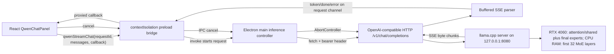

# Qwen Stream Diagnosis

Date: 2026-08-13

Branch: `codex/fix-qwen-streaming`

## Result

The apparent hang was caused by request construction, not by the SSE transport. Qwen
was emitting `delta.reasoning_content`, while the application intentionally rendered
only `delta.content`. Disabling hidden reasoning produced visible content immediately.
The request also lacked an output cap, which was corrected independently.

The repaired path was verified through the production Electron main process, preload
bridge, per-request IPC event channel, React state, and rendered assistant bubble.

## Step 0: Ground Truth

The first probe found no listener on `127.0.0.1:8080`; all curl requests returned HTTP
`000`. The existing runtime script was started and the probes were repeated. A first
PowerShell curl POST also produced a malformed-JSON HTTP 500 because the shell removed
embedded quotes. Piping the JSON body to curl stdin removed that test artifact.

Credential reporting is intentionally sanitized:

```text
LLM credential set: true
LLM credential length: 64
```

Initial server probes:

```text
GET http://127.0.0.1:8080/health
HTTP 200
{"status":"ok"}

GET http://127.0.0.1:8080/v1/models (authenticated)
HTTP 200
model id: Qwen/Qwen3.6-35B-A3B
training context: 262144
parameters: 34660610688
model bytes: 22123538944

GET http://127.0.0.1:8080/slots (authenticated)
HTTP 200
[{"id":0,"n_ctx":8192,"speculative":false,"is_processing":false}]

POST /v1/chat/completions without Authorization
HTTP 401
```

Initial non-stream request, before the fix:

```text
HTTP 200
elapsed: 4.531 s
max_tokens: 16
message.content: ""
message.reasoning_content: populated
prompt: 6.43 tokens/s
generation: 8.10 tokens/s
```

Initial stream request, before the fix:

```text
HTTP 200
elapsed: 10.494 s
role frames: 1
delta.reasoning_content frames: approximately 64
delta.content frames: 0
terminal frame: data: [DONE]
prompt: 19.74 tokens/s
generation: 6.72 tokens/s
```

The exact minimal pre-fix body captured from the app's construction logic was:

```json
{"model":"Qwen/Qwen3.6-35B-A3B","messages":[{"role":"user","content":"Count to five"}],"temperature":0.2,"stream":true}
```

Header names were `Content-Type` and `Authorization`; Authorization was present. The
endpoint was `POST /v1/chat/completions`.

Adding only the request controls later committed to the app produced:

```text
max_tokens: 128
chat_template_kwargs.enable_thinking: false
HTTP 200
time to first visible token: 758 ms
SSE frames: 15
delta.content frames: 13
delta.reasoning_content frames: 0
rendered text: 1, 2, 3, 4, 5
```

Final sanitized probes after all repairs:

```text
health: HTTP 200 {"status":"ok"}
models: HTTP 200, Qwen/Qwen3.6-35B-A3B
slots: HTTP 200, slot 0 idle, n_ctx 8192, speculative false
unauthenticated inference: HTTP 401
non-stream: HTTP 200, 798 ms, content "OK"
stream: HTTP 200, first token 700 ms, 2077 ms total
stream content events: 14
stream content: 1, 2, 3, 4, 5!
```

## Actual Runtime

Current `llama-server --version` after the performance pass:

```text
version: 0.1.0-dev (build 10423, commit a94d563ed)
built with Clang 20.1.8 for Windows x86_64
```

The running command line is:

```text
llama-server.exe
  --model Qwen3.6-35B-A3B-UD-Q4_K_M.gguf
  --host 127.0.0.1
  --port 8080
  --alias Qwen/Qwen3.6-35B-A3B
  --ctx-size 8192
  --n-gpu-layers all
  --n-cpu-moe 32
  --parallel 1
  --flash-attn on
  --cache-type-k q8_0
  --cache-type-v q8_0
  --load-mode none
  --jinja
  --api-key-file <local file path>
```

Startup log:

```text
0.00.237 I load_model: loading model ...Qwen3.6-35B-A3B-UD-Q4_K_M.gguf
0.20.083 I llama threadpool init, n_threads = 16
0.20.922 I initializing, n_slots = 1, n_ctx_slot = 8192
0.20.941 I model loaded
0.20.941 I listening on http://127.0.0.1:8080
```

Eager model load takes about 21 seconds, then avoids paging CPU expert weights during
the first request. The first 32 sparse-expert layers remain in system RAM; attention,
shared tensors, and the final expert layers are eligible for GPU placement.

GPU snapshot:

```text
NVIDIA GeForce RTX 4060 Laptop GPU
VRAM total: 8188 MiB
VRAM used: 6375 MiB
VRAM free: 1582 MiB
```

## Layer Diagnosis

### Layer 1: Request Construction

Observed:

- `stream: true`, Authorization, content type, and endpoint path were correct.
- `max_tokens` was absent.
- Qwen thinking was enabled implicitly, so the server emitted reasoning-only deltas.

Fixes:

- `07fdc43`: add `chat_template_kwargs: { enable_thinking: false }`.
- `1fee147`: add `max_tokens: 1024`.

Each was built and exercised through the app before the next fix was applied.

### Layer 2: Consumption and SSE Parsing

Observed:

- The app already reads `response.body` with a reader loop.
- Visible tokens are correctly read from `choices[0].delta.content`.
- The initial parser had a cross-chunk text buffer, but it was not independently tested
  against every hostile byte split.

Fix:

- `b3c8749` extracts the parser and tests one-byte splits through `data:`, JSON,
  multibyte UTF-8, and `[DONE]`. It also tests multiple events in one chunk.

### Layer 3: IPC Boundary

Observed:

- The request is initiated with `ipcRenderer.invoke`, but streamed data does not ride
  the invoke result. Main sends token events with `event.sender.send` on a unique
  `agent-force:qwen-stream:<requestId>` channel registered before invocation.
- The preload owns the Electron listener and forwards events to the renderer callback.
- Listener cleanup existed but did not abort server work.

Fix:

- `061d5f8` tracks active requests by sender and request ID, aborts on renderer cleanup,
  separates connection and inactivity timers, and classifies auth, timeout, and parse
  errors. A completed stream detaches without a late abort.

Runtime proof: cancellation changed llama.cpp's only slot from processing to idle in
562 ms. The server log records `cancel task` followed by `release`.

### Layer 4: Renderer

Observed:

- Functional state used immutable array replacement and the assistant bubble was bound
  to the same `content` field receiving token events.
- The empty bubble rendered only `...`, which made reasoning-only output, slow prompt
  evaluation, transport failure, and cancellation visually indistinguishable.

Fix:

- `d595f6f` adds named lifecycle states, state-specific copy, elapsed time, token count,
  a Cancel action, and surfaced health/bridge errors.

Runtime proof:

```text
observed states: connecting -> generating -> complete
assistant text: UI_STREAM_COMPLETE
elapsed: 1.0 s
content events shown as tokens: 3
second request: Cancel visible while slot busy
final state: cancelled
slot idle after cancellation: true
server stopped: server-unavailable rendered in 122 ms
```

## Operational Architecture



`LLM_BASE_URL`, `LLM_API_KEY`, and `LLM_MODEL_NAME` remain the provider boundary. A
hosted OpenAI-compatible endpoint can be selected through environment configuration
without changing code.

## Escalation Review

No ESCALATE condition was hit. No dependency was added, the preload function signature
and exposed bridge surface were preserved, credential storage was not changed, and all
edits stayed in the inference path or its requested documentation/tests. The invoke call
is control-plane initiation only; the stream itself uses subscribe-style IPC events.

## Verdict

The optimized profile makes short and medium Agent FORCE chat interactive: the retained
benchmark averages 3.343 seconds and a prefix-reused Electron turn completed in 0.64
seconds. Deterministic next actions should still render immediately for long prompts,
with Qwen adding rationale asynchronously.
